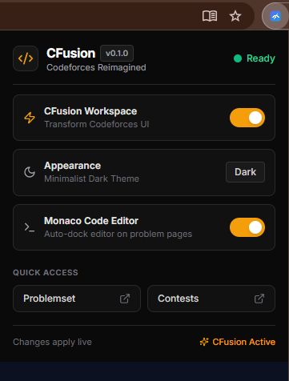
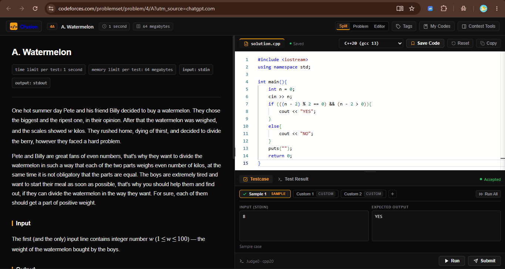
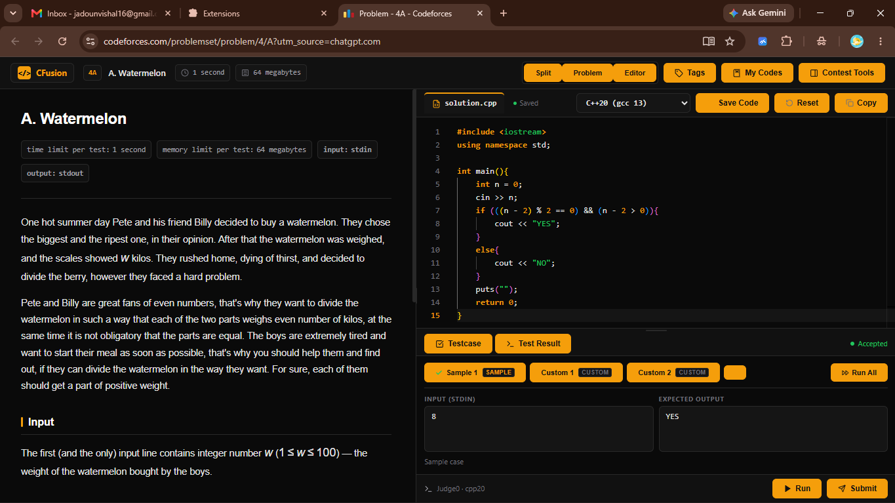
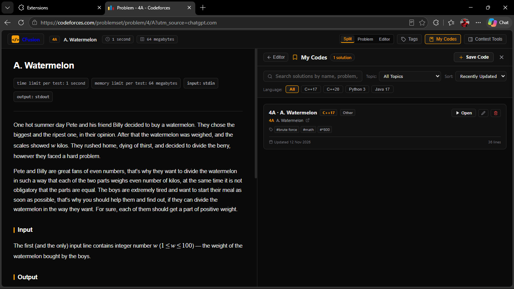

# CFusion — Codeforces Reimagined

<p align="center">
  <strong>A modern competitive programming workspace built directly into Codeforces.</strong>
  <br />
  Write, test, debug, and manage your solutions without leaving the problem page.
</p>

<p align="center">
  
</p>

---

## Overview

**CFusion** transforms the traditional Codeforces problem-solving experience into a modern, integrated coding environment.

It combines a redesigned Codeforces interface, Monaco Editor, split-screen workspace, custom test case management, personal code library, and cloud-based code execution into a single browser extension.

Instead of switching between multiple tabs, external editors, and online compilers, CFusion brings essential competitive programming tools together in one place.

## Features

### 1. Modern Codeforces Workspace
- Minimalist dark interface with a clean design.
- Redesigned problem-solving experience.
- Split-screen layout with independently scrollable panels.
- Adjustable problem and editor widths.
- Dedicated Problem, Editor, and Split views.
- Quick access to Codeforces problemsets and contests.

### 2. Integrated Monaco Code Editor
- Full Monaco Editor integration.
- Syntax highlighting and familiar editor experience.
- Multiple programming language support.
- Automatic code saving and restoration.
- Language-specific code persistence for individual problems.
- Locally bundled editor assets.

### 3. Multi-Language Code Execution
Execute code directly from the workspace through the Judge0 execution engine.

| Language | Compiler / Runtime |
|---|---|
| C++17 | GCC 9.2.0 |
| C++20 | GCC 14.1.0 |
| Python 3 | Python 3.11.2 |
| Java 17 | OpenJDK 17.0.8 |

### 4. Custom Test Case Management
- Automatic extraction of sample test cases from Codeforces.
- Create and manage custom test cases.
- Run individual test cases or execute all cases.
- Compare actual output with expected output.
- Identify Accepted and Wrong Answer results.
- Inspect standard input, standard output, and execution diagnostics.
- Stop an ongoing test run.

### 5. Personal Code Library
Save and organize your solutions without leaving Codeforces.

- Save solutions with custom names.
- Organize solutions by problem and programming language.
- Search and filter saved solutions.
- Sort solutions by recent updates.
- Open, rename, and delete saved code.
- Store solutions locally using browser storage.

### 6. Customizable Extension
- Interactive browser popup.
- Enable or disable the CFusion workspace.
- Switch between available appearance settings.
- Control Monaco Editor integration.
- Persistent user preferences.
- Quick access to Codeforces problemsets and contests.

---

## Screenshots

### CFusion Extension Popup

Manage your workspace, appearance, and editor settings through the extension popup.


### Integrated Codeforces Workspace

A redesigned Codeforces experience with problem navigation, split-screen controls, and an integrated coding environment.



### Monaco Editor and Test Case Management

Write solutions, select programming languages, execute code, and validate sample or custom test cases.



### Personal Code Library

Save, search, filter, and manage your previously written solutions.



---

## Technology Stack

| Category | Technologies |
|---|---|
| Extension Platform | Chrome Extension Manifest V3 |
| Frontend | React 18, JavaScript |
| Styling | Tailwind CSS |
| Code Editor | Monaco Editor |
| Icons | Lucide React |
| Build Tool | Vite, Rollup |
| Browser Storage | Chrome Storage API |
| Backend | Node.js, Express.js |
| Code Execution | Judge0 API |
| Version Control | Git, GitHub |

---

## System Architecture

CFusion uses a browser extension frontend connected to a backend service that handles code execution requests.

```text
                  CODEFORCES
                      |
                      v
             CFUSION EXTENSION
                      |
          +-----------+-----------+
          |                       |
          v                       v
    React Workspace          Monaco Editor
          |                       |
          +-----------+-----------+
                      |
                      v
             Background Service
                      |
                      v
              CFusion API Server
                Node.js / Express
                      |
                      v
                  Judge0 API
                      |
                      v
              Execution Results
                      |
                      v
              CFusion Workspace
```

### Key Architectural Decisions
- Manifest V3 for modern browser extension compatibility.
- Locally bundled Monaco Editor assets.
- Background service worker for execution requests.
- Node.js backend to keep execution-service credentials off the client.
- Judge0 integration for remote code compilation and execution.
- Browser-local storage for preferences and saved solutions.

---

## Installation

### Option 1: Install from Microsoft Edge Add-ons

Once the CFusion beta listing is published, users will be able to install it directly from the Microsoft Edge Add-ons Store.

### Option 2: Install Manually

**Step 1 — Clone the repository**

```bash
git clone https://github.com/Vishaljadoun63/CFusion.git
cd CFusion
```

**Step 2 — Install dependencies**

```bash
npm install
```

**Step 3 — Build the extension**

```bash
npm run build
```

The production-ready extension will be generated inside the `dist/` directory.

**Step 4 — Load the extension**

For Google Chrome:
1. Open `chrome://extensions/`.
2. Enable Developer mode.
3. Click **Load unpacked**.
4. Select the project's `dist/` folder.

For Microsoft Edge:
1. Open `edge://extensions/`.
2. Enable Developer mode.
3. Click **Load unpacked**.
4. Select the project's `dist/` folder.

For Brave:
1. Open `brave://extensions/`.
2. Enable Developer mode.
3. Click **Load unpacked**.
4. Select the project's `dist/` folder.

**Step 5 — Start coding**

Visit Codeforces, open a problem, and launch the CFusion workspace.

---

## Backend Configuration

CFusion uses a Node.js backend to communicate with the Judge0 execution API.

For local development:

**Step 1 — Configure environment variables**

Create a `.env` file inside the `server/` directory using `server/.env.example` as a reference.

Configure the Judge0 API endpoint and any provider credentials required by your selected service.

**Step 2 — Install backend dependencies**

```bash
cd server
npm install
```

**Step 3 — Start the backend**

```bash
node server.js
```

The local backend uses port `3001` by default.

For distributed installations, the backend should be deployed and accessible over HTTPS.

> Never commit `.env` files, API keys, or private credentials to GitHub.

---

## Development

To work on CFusion locally:

```bash
# Install frontend dependencies
npm install

# Build the production extension
npm run build

# Start the local backend from the project root
npm run dev
```

After making changes to extension files, rebuild the project and reload the unpacked extension from the browser's extensions page.

---

## Project Structure

```text
CFusion/
│
├── public/
│   ├── icons/
│   └── manifest.json
│
├── screenshots/
│   ├── popup.png
│   ├── workspace.png
│   ├── editor.png
│   └── my-codes.png
│
├── src/
│   ├── background/
│   ├── content/
│   ├── editor/
│   ├── popup/
│   └── services/
│
├── server/
│   ├── server.js
│   ├── package.json
│   └── .env.example
│
├── scripts/
├── index.html
├── package.json
├── vite.config.js
├── vite.content.config.js
├── vite.worker.config.js
└── README.md
```

---

## Privacy and Data

- User preferences and saved solutions are stored locally in browser storage.
- Code execution requests are sent to the configured CFusion backend.
- The backend forwards execution requests to Judge0.
- Backend credentials are kept on the server rather than in the extension package.

Please avoid including passwords, API keys, or other sensitive information in source code or test inputs.

---

## Release

**CFusion v1.0.0 — Beta**

The initial release brings together the integrated Codeforces workspace, Monaco Editor, multi-language execution, custom testing tools, and personal code library.

The project is being prepared for distribution through Microsoft Edge Add-ons.

---

## Future Improvements

- Export and import of saved code libraries.
- Cloud synchronization across devices.
- Additional competitive programming productivity tools.
- Further interface and performance improvements.

---

## Contributing

Contributions, bug reports, and feature suggestions are welcome.

1. Fork the repository.
2. Create a feature branch.
3. Make your changes.
4. Submit a pull request with a clear description.

---

## Author

**Vishal Jadoun**

Electronics and Communication Engineering Student | Software Development & AI/ML Enthusiast

- GitHub: [@Vishaljadoun63](https://github.com/Vishaljadoun63)
- Repository: [CFusion](https://github.com/Vishaljadoun63/CFusion)

---

<p align="center">
  <strong>CFusion — Your Codeforces workflow, reimagined. 🚀</strong>
</p>